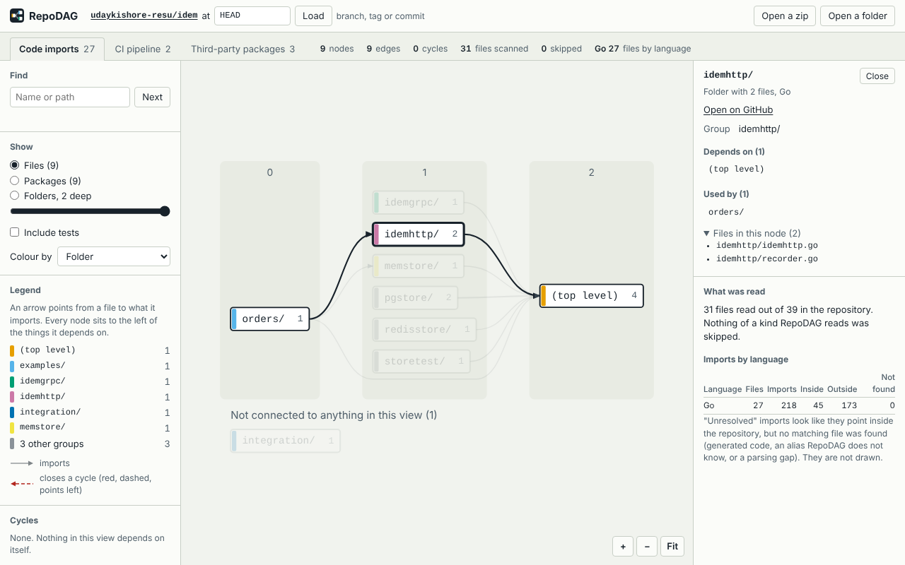

# RepoDAG

> Chrome extension. Draws how a repository fits together: it downloads the source of a GitHub repository (or reads a zip or folder from your computer), works out which files import which, how the CI jobs depend on each other and which third-party packages are asked for, and draws each as a layered graph that reads from left to right. Everything runs in the browser tab.

**Topics:** `chrome-extension` `manifest-v3` `dependency-graph` `code-visualization` `static-analysis` `import-graph` `github-actions` `graph-layout` `monorepo` `javascript`



## What it draws

| Tab | Nodes | Edges |
|---|---|---|
| **Code imports** | Files (Go: packages, and with tests included their external test packages), or folders at a depth you choose | "imports". Resolved only to things inside the repository. Merged edges carry a count |
| **CI pipeline** | One per job in `.github/workflows/*.yml` | `needs:`, calls to reusable workflows in the same repository, `workflow_run` triggers |
| **Third-party packages** | One per manifest, one per direct dependency | "asks for", with the version. A package used by several manifests is one shared node |

Columns are layers: every node sits to the left of what it depends on (in the CI tab, to the left of the jobs that wait for it, so the pipeline reads in the order it runs). Cycles are listed; the edge that closes one is drawn red **and** dashed, pointing against the flow. Dependencies needed only for development, builds or tests are drawn dotted and can be hidden. Click a node for its details, search by name, switch between files, packages and folders, and export the view as SVG, Mermaid, Graphviz DOT or JSON.

Import languages: Go, JavaScript and TypeScript, Python, Java, Kotlin, Scala, Rust, C and C++.
Manifests: `go.mod`, `package.json`, `requirements*.txt`, `pyproject.toml` (PEP 621 and Poetry), `Cargo.toml`, `pom.xml`, `build.gradle(.kts)`, `build.sbt`.

## Install (unpacked)

1. Open `chrome://extensions` and turn on **Developer mode**.
2. Click **Load unpacked** and pick the `extension` folder of this repo.
3. Open any repository page on github.com, click the RepoDAG toolbar icon, then **Map this repository**.

No GitHub page at hand? Click the toolbar icon anywhere and choose **Open a zip or folder from your computer**, then drop a zip or a folder on the page.

## Repo layout

| Path | What it is |
|---|---|
| `extension/` | The extension itself. This folder is what Chrome loads and what gets zipped for the store |
| `extension/popup.html`, `popup.js` | Toolbar popup: recognises a repository page and opens the viewer |
| `extension/viewer.html`, `viewer.js`, `viewer.css` | The viewer tab: loading, controls, SVG drawing, pan and zoom, exports |
| `extension/background.js` | An empty service worker (see the comment in the file) |
| `extension/lib/zip.js` | Zip reader: central directory, stored and deflate entries, on-demand unpacking |
| `extension/lib/lex.js` | Comment and string blanking, the JS/TS import scanner, path helpers |
| `extension/lib/imports.js` | Import parsing and resolution for every language |
| `extension/lib/workflows.js` | GitHub Actions workflows to jobs and edges |
| `extension/lib/manifests.js`, `toml.js` | Dependency manifest readers, and the small TOML reader they use |
| `extension/lib/scan.js` | Entry point: which files to read, then the three raw graphs from a `Map<path, text>` |
| `extension/lib/views.js` | Raw results to drawable graphs: aggregation levels, test toggle, labels, groups |
| `extension/lib/graph.js` | Strongly connected components, cycle listing, layered layout, edge routes |
| `extension/lib/export.js`, `ghurl.js` | Mermaid / DOT / JSON text, GitHub URL handling |
| `extension/lib/js-yaml.min.js` | js-yaml 4.1.0 (MIT, licence alongside), the only third-party file |
| `test/` | Unit tests (Node's built-in runner, no dependencies). `test/fixtures/polyglot` is a small repository with one of everything, whose graph `pipeline.test.js` spells out by hand |
| `e2e/` | Playwright harness: the real extension in Chromium against a real archive and the fixture repository in `e2e/fixtures/demo-repo` |
| `store/` | Chrome Web Store assets, `LISTING.md` with every field's text, and the scripts that regenerate the images |
| `scripts/package.sh` | Builds `dist/repodag-<version>.zip` for upload |
| `scripts/scan-cli.js` | Runs the same scanner over a folder or zip from the command line and prints the numbers |

Every file in `extension/lib/` is plain JavaScript wrapped in an IIFE that attaches to `globalThis.RepoDag…` and also sets `module.exports`, so the page and the Node tests load the same code. There is no build step.

## How it works

```
popup.js                         viewer.js                                      lib/
  current tab is                   GET github.com/<o>/<r>/archive/<ref>.zip  ->  zip.js      central directory, then only
  github.com/<o>/<r>[/tree/<ref>]  (or a dropped zip / chosen folder)                        the files the scanners want
        |                              |
        +-- opens viewer.html?repo= ---+--> Map<path, text> ------------------>  scan.js
                                                                                   imports.js    file -> file | package
                                                                                   workflows.js  job  -> job
                                                                                   manifests.js  manifest -> package
                                       views.js  level, tests, labels, groups  <-  raw graphs
                                       graph.js  cycles, layers, order, coordinates, routes
                                       SVG built with createElementNS
```

- **Reading.** The archive is held in memory. The zip's central directory lists every file; only source files, manifests, workflows and a few config files are unpacked, each with `DecompressionStream('deflate-raw')`. Files over 1 MB, minified files and the folders `node_modules, vendor, dist, build, target, out, .git, __pycache__, .venv, venv, third_party, testdata` are skipped and counted.
- **Imports.** Each language has its own reader that removes comments and string contents first, then finds import statements and resolves them the way that language does (Go module paths, Node and TypeScript probing with workspace packages and `tsconfig` paths, Python package roots and relative imports, JVM packages, Rust module trees and path dependencies, C include lookup). An import is only drawn when it lands on a real file or package in the repository. Everything else is counted as "outside" or "not found" and shown in the side panel, never guessed.
- **Layout.** Strongly connected components are found with an iterative Tarjan. Inside each component a greedy ordering (Eades, Lin and Smyth) picks the few edges to turn around so the rest is acyclic. On the 32 views with cycles among the test repositories it never turned more edges than a plain depth-first walk would, and fewer in 22 of them (gson: 23 against 54, poetry: 22 against 60). Layers come from the longest path. An edge that skips columns gets a pass-through point in every column it crosses, and long edges that share an end share those points, so twenty files importing one distant utility run as one trunk instead of twenty lanes (turned-around edges keep to trunks of their own). Columns are ordered by repeated barycentre sweeps, keeping the order with the fewest crossings; vertical positions are a least-squares fit that keeps nodes apart. Nothing recurses.
- **Drawing.** One `<g>` carries the pan and zoom transform, so moving the view changes a single attribute however large the graph is. Views above 600 nodes are not drawn until you group them or ask for it.

## Develop

```bash
npm test                 # unit tests: zip, parsers, resolvers, workflows, manifests, graph layout, exports, store limits
npm install              # only needed for the next three (installs Playwright)
npx playwright install chromium
npm run e2e              # loads the extension in Chromium; maps one small public repository from GitHub
npm run screenshots      # regenerates the 1280x800 store screenshots and the promo tile from a real graph
npm run package          # builds dist/repodag-<version>.zip
npm run scan -- <folder-or-zip> [--tests] [--unresolved] [--edges] [--pkg-edges]   # the scanner on the command line
```

`npm run e2e` and `npm run screenshots` map `github.com/udaykishore-resu/idem` through the extension's own download. On a network that blocks GitHub's archive hosts but allows `git clone`, both scripts notice the failed download, clone the repository, build the same zip with `git archive` and answer the extension's request with it; the log says which happened. To use a zip you already have:

```bash
git clone --depth 1 https://github.com/udaykishore-resu/idem /tmp/idem
git -C /tmp/idem archive --format=zip --prefix=idem-HEAD/ HEAD -o /tmp/idem.zip
REPODAG_E2E_ZIP=/tmp/idem.zip npm run e2e
```

`npm run icons` redraws the icons from `store/icon.svg`.

To release: raise `version` in `extension/manifest.json` and `package.json`, run `npm run package`, upload the zip in the Chrome Web Store developer dashboard. `store/LISTING.md` has the text for every field.

## How accurate is it

Each language was compared with an independent tool on public repositories (shallow clones, October 2026). "Edges" are file-level unless stated. A wrong edge counts for more than a missing one, so the table says which way every difference goes.

| Repository | Compared with | Result |
|---|---|---|
| `udaykishore-resu/idem` (Go, 3 modules) | `go list` in every module (`Imports`, `TestImports`, `XTestImports`) | 9 package edges, identical. With tests: 9 packages and 7 external test packages, 32 edges, identical, with every `XTestImports` entry starting at the `x_test` package and not at `x`. No cycles |
| `gin-gonic/gin` (Go) | `go list` | 11 package edges, identical. With tests: 12, and `go list` has 3 more, all into `testdata/`, which is ignored. No cycles |
| `honojs/hono` (TypeScript) | TypeScript's own import scanner and module resolver | 1,415 import specifiers on both sides. All 1,021 relative imports TypeScript resolves are drawn. The other 71 edges come from `adapters/*` importing the root package by name; a separate reading of the `exports` table gives the same 71 targets |
| `trpc/trpc` (TypeScript monorepo) | same, with each folder's `tsconfig` | 3,791 specifiers on both sides. All 1,436 relative imports are drawn. Of 718 imports TypeScript resolves through `tsconfig` paths, all 718 land on the same file. Of 185 imports naming a workspace package, 184 are drawn into that package; the last points into a folder named `vendor`, which is ignored |
| `expressjs/express` (CommonJS) | same | 400 `require` specifiers and 153 edges, identical |
| `pallets/flask`, `encode/httpx`, `aio-libs/yarl`, `fastapi/typer`, `python-poetry/poetry` (Python) | Python's `ast` module and a module-name table | Imported names: 675, 512, 412, 2,213 and 4,356, the same on both sides. Edges: 191, 122, 70, 798 and 1,136, identical sets |
| `google/gson` (Java, main module) | `javac` and `jdeps` on the compiled classes | 387 of the 388 class-file dependencies are drawn; the one missing never appears in the source text. 21 more are drawn that exist only in source: 20 imports used only in Javadoc or for an inlined constant, and one source-only annotation. Of the 102 links inferred between classes of the same package, `jdeps` confirms 101 |
| `square/moshi` (Kotlin and Java) | a plain search for imports that name a class or function declared in the repository | 364 of 368 agree; the 4 others are import lines inside string literals, which RepoDAG ignores on purpose. No Kotlin compiler was available |
| `scopt/scopt` (Scala) | the same search, then by hand | 23 import edges: 5 match the search, 18 are Scala's relative imports (`import OEffect._`) and were read one by one |
| `BurntSushi/ripgrep` (Rust workspace) | `cargo metadata`, a count of `mod` lines, and a resolver that follows the file layout | All 18 path dependencies between crates are found. 89 `mod x;` lines, 89 module edges. The 392 `use crate::…` paths give 156 file-to-file links by layout; all 156 are drawn. No compiler-level check was available for Rust |
| `google/leveldb` (C++), `redis/hiredis` (C) | `g++ -H` and `gcc -H` on every source file | All 364 and all 92 include edges the compiler reports are drawn. 134 and 28 more are drawn; each has an `#include` line that reaches that file, which the compiler skipped because the header was already in |
| all of the above (workflows) | PyYAML | Jobs, `needs` edges, local reusable-workflow calls and `workflow_run` links are identical in all 15 repositories that have workflows (yarl: 19 jobs, 33 `needs`, 4 calls) |
| all of the above (manifests) | `go mod edit -json`, `json`, `tomllib`, an XML parser | The 1,386 declared dependencies in `go.mod`, `package.json`, `pyproject.toml`, `requirements*.txt`, `Cargo.toml` and `pom.xml` files are the same on both sides. Gradle and sbt files were only read by eye |

This checking found two mistakes, both fixed. In Rust, `crate::search(args)` was drawn to the module `search` when it calls the function `search` in the crate root. In Go, test files of an external test package (`package idem_test`) were counted as part of the package in their folder, which made idem with tests on show a cycle that Go would never compile; they are now a package of their own, as they are to the compiler, and idem, gin and cobra report no cycle at any level with tests on or off. Not covered by any tool: links inferred inside Kotlin and Scala packages, Java test sources, and Rust paths other than `use crate::…`.

## Limits

- **It reads text, it does not compile.** Imports created at run time (`importlib`, `require(variable)`, reflection), code generated at build time and conditional compilation are not understood. Every import that looks internal but matches no file is counted under "Not found" in the side panel, with a sample list.
- **Private repositories are untested.** The download is made with your GitHub cookies, which should let private repositories you can see work. What was tested: the live download of public repositories from GitHub, redirect to `codeload.github.com` included, and, against a local stand-in for GitHub, that the session cookie goes to `github.com` and is not passed on. A real private repository was never tried.
- **Ignored folders can hide real code.** A source folder that happens to be called `build`, `vendor`, `out`, `dist` or `target` is skipped (hono keeps build scripts in `build/`, trpc keeps sources in a `vendor/`). Imports that point into one are counted separately ("point into ignored folders").
- **Size.** Archives over 200 MB are refused, files over 1 MB are skipped, zip64 and encrypted zips are rejected. The largest real repository tried is trpc/trpc: 1,647 files, 1,173 of them read. A synthetic one with 1,500 source files loads in about a second and a half. Repositories with tens of thousands of files have not been tried. Everything is held in memory.
- **Branch names with a slash.** The popup takes the ref from the address, `/tree/<ref>/...`, and cannot tell where a branch such as `feature/x` ends, so it opens `feature`. Correct it in the box at the top of the viewer and press Load.
- **JavaScript and TypeScript.** `tsconfig` / `jsconfig` `paths` and `baseUrl` are read (with relative `extends`), as are workspace package names and package.json `imports`. Aliases defined only in bundler configuration are not. `.vue`, `.svelte` and `.astro` files are not read. Type-only imports are edges like any other. An import of a workspace package whose file cannot be pinned down is drawn to the package folder.
- **Python.** Source roots are inferred (the repository root, `src/`, folders with a `pyproject.toml` or `setup.py`, the top of each `__init__.py` chain), not taken from `sys.path` settings. Cython and C extension modules are not read; imports of them are counted as outside. A name such as `poetry.core` that shares its first part with a local package counts as outside only when a manifest in the repository asks for `poetry-core`; otherwise it is reported as not found.
- **Java, Kotlin, Scala.** Types used from the same package need no import, so those links are inferred from capitalised names that match a declaration in a neighbouring file. A fully qualified name used without an import is not seen, nor is a Kotlin top-level function called from its own package. Scala implicits and package objects are not understood. A Scala import of an object that every platform folder defines is drawn to each of them.
- **Rust.** `mod` declarations, `use` trees, paths starting with `crate`, `self`, `super` or a path dependency, and `extern crate` are followed. A path through a re-export points at the module that re-exports, not the one that defines; in an expression such as `flags::parse()` the last name is taken to be an item, so the link goes to `flags`. `mod` generated by macros and `#[cfg_attr(..., path = ...)]` are missed. Modules of one crate may refer to each other freely, so cycles between files of a crate are normal.
- **C and C++.** `#include "..."` is looked up next to the including file, from the repository root, then by a unique path suffix. `#include <...>` is followed only when it names a file by its path from the repository root, `include/` or `src/`; anything else in angle brackets counts as a system header. Include paths from build files are not read, `#if` is not evaluated, and a name that matches several files is left unresolved.
- **Go.** Build tags are ignored (every file counts), so two files that are never compiled together can still be drawn in one package. Without a `go.mod` nothing is matched. With tests included, an external test package (`package x_test`) is a node of its own with a dashed outline, named after its package clause; test files that say `package x` stay part of `x`. When folders are merged to a depth, the external test packages under one folder share one node next to it, so a loop between folders is never caused by them.
- **CI.** Only `.github/workflows` is read. Matrices are not expanded, `if:` is shown but not evaluated, composite actions and reusable workflows in other repositories are not followed. Job names are shown as written, `${{ }}` expressions included.
- **Packages.** Direct dependencies only; lock files are not read. Gradle and sbt files are matched with patterns, so dependencies built in code are missed and a version held in another file shows as its variable name. Maven versions inherited from a parent POM are blank.
- **Drawing.** Long import chains make wide drawings; the first view shows the left end at a readable size and "Fit" shows everything. A column with a hundred packages is a hundred rows tall. Nodes cannot be dragged. Mermaid refuses graphs over 500 edges unless its `maxEdges` setting is raised.
- **Saving files.** Chrome may ask before a page saves several files in a row; the page cannot see the answer, so it reports that a download started, not that it finished.
- **Folder picker.** Chrome lists every file of a chosen folder before the page sees any, including `node_modules`. Dropping the folder on the page instead skips the ignored folders up front.

## Privacy

See [PRIVACY.md](PRIVACY.md). The only network request is the download of the repository archive from GitHub, made when you ask for it. Local zips and folders are read in the tab and never uploaded. Nothing is stored, there are no analytics and no server of mine. The manifest's content security policy allows connections to `github.com` and `codeload.github.com` only.

Permissions: `activeTab` (to read the address of the tab you click the icon on) and host access to `github.com` and `codeload.github.com` (to download the archive).

## Skills demonstrated

Manifest V3 (popup, extension page, strict content security policy) · zip parsing and streaming decompression in the browser · lexing and import resolution for ten languages · layered graph drawing (Tarjan SCC, feedback arc heuristic, longest-path layering, edge bundling, crossing reduction, constrained coordinate assignment) · accessible SVG with keyboard navigation, light and dark themes · DOM built without `innerHTML` · verification against compilers and build tools · Playwright extension testing

## License

MIT. See [LICENSE](LICENSE). The bundled js-yaml is MIT, see `extension/lib/js-yaml.LICENSE`.
